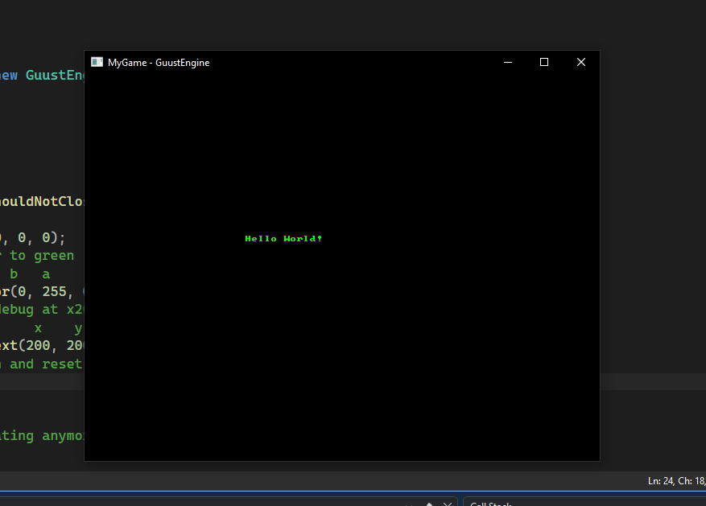

# GuustEngine

> [!CAUTION]
> This is very new, as for the engine as for this repo. Expect bugs, errors, and unclear signs. Want to help or see a bug? make a [PR](/PULL_REQUEST.md) :). 

GuustEngine is a 2D game engine to make simple c++ games or projects. \
Originally called "BreadEngine", the engine we use internly for learning and testing. 

> [!IMPORTANT]
> This isnt a full game engine like [Unity](https://unity.com/) or [Unreal](https://www.unrealengine.com/) or [Godot](https://godotengine.org/) but more as an simple c++ framework. but it might later be... (who knows? i don't..)

> [!IMPORTANT]
> The engine's source is not yet available here because it not that clean yet and contains a bit of (platform) console code. 

#### What can you do with this engine?
- Make 2D games
- Make software
- Test stuff out
- Learn c++ and game engines
- Fuck around
- Release a game with this.

#### What can you beter not do:
- make GTA7 with this.

#### Releasing something using this engine:
If you'd made something with this engine, what would be **very cool**
under the [LICENSE](/LICENSE) you can go commercial with no problem! \
If you do let us [know](/PULL_REQUEST.md), maybe we can support and help!


## C++ code overview (windows)[^1].
[^1]: It is technically cross platform.

[**HelloWorld_Simple Example**](/Examples/Any/HelloWorld-Simple/)

```C++
// include the engine to use it
#include <GuustEngine.hpp>

int main() {
	// make copy (object)
	GuustEngine* engine = new GuustEngine();
	AppConfig config;

	// start engine
	engine->Init(config);

	// update engine
	while (engine->TargetShouldNotClose()) {
		// update systems
		engine->Update(0, 0, 0, 0);
		// set color picker to green
		//			r   g   b   a
		engine->SetDrawColor(0, 255, 0, 255);
		// write text for debug at x200,y200
		//                     x    y
		engine->DrawDebugText(200, 200, "Hello World!");
		// clear the screen and reset.
		engine->Swap();
	}

	// when engine not updating anymore
	// stop the engine
	engine->Destroy();

	// remove the copy (object) we made.
	engine = nullptr;
	delete engine;
}
```
> wow only 20 lines (without comments and new lines)




# Compiled Binaries:
You can find the binaries (*GuustEngine.dll/.lib/.hpp*) in [Releases](https://github.com/NeoCircuit-Studios/GuustEngine/releases) and in the [Repo Source Files](/Engine).

## How to start ?

#### Windows:

1. Install **[GitHub Desktop for Windows](https://desktop.github.com/)** then **[fork and clone this repository](https://guides.github.com/activities/forking/)**. 
	- When GitHub Desktop is finished creating the fork, it asks, **How are you planning to use this fork?**. Select **For my own purposes**. This will help ensure that any changes you make stay local to your repository and avoid creating unintended pull requests. You'll still be able to make pull requests if you want to submit modifications that you make in your fork back to this repository.

	- Or you can just get the source with the **Download ZIP** button on this page.

	- Or just use Git cli.

1. Install **Visual Studio 2022** or newer: 
	- All desktop editions of Visual Studio can be used, 17.8 or later **should** work, but Visual Studio 2026 18.x is recommended. It is free for small teams and individual developers.

1. In **Visual Studio Installer** install 'Desktop development with C++'. 

1. In the Source folder of this repo (called '**GuustEngine**'). Load the project with Visual Studio by double-clicking the '**GuustEngine.slnx**' file.  ***(GuustEngine/GuustEngine.slnx)***

1. Press on the top rigt the **build** button then press **Build Solution**: it will build all the [**Example**](/Examples/) and [**Sample**](/Samples/) Projects.
	- You will find the build projects in '**x64**' folder in the Source folder of this repo. ***(GuustEngine/x64/)***

1. You can continue from an **example/sample** or start from scratch with the [**EmptyProject**](/EmptyProject/).

#### Linux:
- Sorry not **yet** supported

#### Mac:
- Not planned, but can be requested.

#### Nintendo Switch (NX) **Homebrew [SDK](https://devkitpro.org/wiki/Getting_Started)**:
- Is supported and will be added later.

# Runtime Support:
### Windows
- Windows 10/11 
	- x64 | x86/Win32


# Issus:
Found a bug? look in [KNOWN_ISSUES.md](/KNOWN_ISSUES.md) if not already there, make a [PR](/PULL_REQUEST.md) :).

# LICENSE
Licensed under MIT License

# Contributions
See [PULL_REQUEST.md](/PULL_REQUEST.md) for more info.

# AI
**NO AI allowed nor used in this repo!** \
See more info in [_NO_AI.md](/_NO_AI.md)
